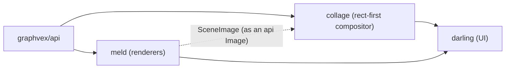

# collage — Rect-First Compositor Manifest

> Status: **manifest only, nothing implemented.** This file is the work order for whoever builds collage.
> Repo `github.com/graphvex/collage`, checked out at `worktree/vex/graphvex/compositor/`.
> Parent manifest: [`_notes/graphvex/MANIFEST.md`](../../../../_notes/graphvex/MANIFEST.md). Sibling: [`../meld/MANIFEST.md`](../meld/MANIFEST.md).

## 0. Clone

```sh
# from the workspace root (~v)
git clone https://github.com/graphvex/collage worktree/vex/graphvex/compositor
```

Cloned 2026-11-17 at `5668df1` (an initial commit with only `LICENSE` and `.gitignore`).
The folder is named `compositor` (the role); the repo is named `collage` (the product).

---

## 1. Role

collage is graphvex's **rect-first compositor**. Everything it handles is a rectangle:

- A widget is a rect.
- A glyph run is a rect.
- An image is a rect.
- A meld 3D/2D scene is a rect (a `SceneImage` placed at an event bound).

collage places rects in painter order, isolates groups, applies ordered filter stacks, clips and masks, tracks damage, and presents the result through graphvex/api's `Swapchain` into the single seam canvas.



The dotted edge carries **data, not an include**. collage takes an api `Image` + version. It never includes meld. darling wires the two together: the 3D panel asks meld for a `MeldView` and hands collage the view's newest image as a `SceneSource`.

| collage may include | collage never includes |
|---|---|
| `graphvex/api` public headers | meld, darling, hotcwap, window headers |
| vexspoke, re, lib | driver headers (`vulkan/`, `metal/`, `direct/`, `wgpu/`) |

Laws it carries (from the graphvex lawbook):
- Graphics Language & Board Compositor
- Absolute Rendering & Event Bound
- Ordered Filter & Scatter Composition
- Independent Scene Cadence
- Strict 0xRRGGBBAA Color
- Seam Canvas Pixel Mapping

---

## 2. The rect-first model

| Concept | Definition |
|---|---|
| **Event bound** | The resolved layout/hit rect in the declared coordinate space. Filters never change it |
| **Absolute bound** | Conservative world-space AABB of this group's and its descendants' paint after effects. Unknown support → full-group fallback or rejection, never an invented margin |
| **Source** | Anything that paints into a rect: solid, image, glyph run, vector shape, scene image |
| **Group** | An isolated composition of child rects into an offscreen target at the group's world origin |
| **Filter stack** | Ordered `ID16 \| payload48` tokens: backdrop → content/foreground → element, left to right, no reordering |
| **Damage** | Union of old and new absolute bounds of anything that moved, changed, was filtered or was removed; backdrop reads add dependencies |
| **Space** | Composition happens in **linear-light premultiplied RGBA**, with f32 accumulation for weighted filters |

Rect-first means the planner, culling, damage and allocation all work on integer native-pixel rects. Rounded corners, masks and SDF shapes refine *inside* a rect; they never replace it as the unit of scheduling.

**collage is forward-rendered.** There is no retained scene and no G-buffer. Each frame, the rect list is sorted in painter order, batched by pipeline and image, and drawn as instanced quads straight into the target. An offscreen group exists only when a filter or mask needs isolation. That's the opposite of meld, which is retained.

**No tessellation.** Every shape is a rect whose fragment shader computes coverage:
- analytic for rect, rounded rect, circle, ellipse and line/stroke caps;
- an **SDF atlas** lookup for glyphs and complex paths (SVG), baked once by compute jump-flood (the `SdfGpu` path from `api_old`).

Shapes are never turned into triangles.

---

## 3. Directory layout and classes

```text
compositor/                (repo: collage)
├── collage.h              door
├── README.md
├── collage-preferences.md repo lawbook
├── rect/  lang/  paint/  text/  element/  source/  group/  filter/  compose/  damage/  schedule/  present/
├── shaders/
└── tests/
```

### 3.0 Moved in from api (api is just the API)

| Folder | File pairs | Role |
|---|---|---|
| `lang/` | `filter.h`, `filter_stack.h`, `compositor.h`, `graphics_component.h`, `element_node.h`, `transform.h`, `size.h` | Graphics-language vocabulary (Graphics Language & Board Compositor law), now owned where it is executed |
| `paint/` | `brush`, `stroke`, `vector_brush`, `raster_brush`, `shape` | Paint records + paths (embed-first upcast); shapes are evaluated as coverage, never tessellated |
| `text/` | `font`, `font_bake`, `sdf_atlas` | Bake-on-demand SDF glyph atlas; `sdf_atlas` also stores complex-path SDFs (compute jump-flood) |

### 3.1 `rect/`
| File pair | Class | Role |
|---|---|---|
| `rect/rect.h/.c` | `Rect` | f32 x/y/width/height in logical space; intersect, union, contains, inset |
| `rect/rect_i.h/.c` | `RectI` | i32 native-pixel rect (allocation, scissor, damage) |
| `rect/corner_radius.h/.c` | `CornerRadius` | Four radii; clamp to rect |
| `rect/insets.h/.c` | `Insets` | Padding/margin/halo, kept apart (layout insets are never filter halos) |
| `rect/pixel_mapping.h/.c` | `PixelMapping` | Logical → native via `backingScaleFactor` (Seam Canvas law) |

### 3.2 `element/` (from `api_old/ui`, `api_old/lang`)
| File pair | Class | Role |
|---|---|---|
| `element/element_node.h/.c` | `ElementNode` | Container in the composition tree (graphvex name, never darling's) |
| `element/graphics_component.h/.c` | `GraphicsComponent` | Placement record (never `Component`) |
| `element/property.h/.c` | `Property` | x/y/w/h + radius/background/border/shadow/blur |
| `element/size.h` | — | `SIZE_AUTO` sentinel + per-class AUTO equivalence |
| `element/bounds.h/.c` | `Bounds` | `eventBound` / `absoluteBound` resolution |

### 3.3 `source/`
| File pair | Class | Role |
|---|---|---|
| `source/source.h/.c` | `Source` | Tagged source record + `kind` |
| `source/solid_source.h/.c` | `SolidSource` | 0xRRGGBBAA fill |
| `source/image_source.h/.c` | `ImageSource` | api `Image` + fit (`Image_fitRect` / `drawImageFit` only) |
| `source/glyph_source.h/.c` | `GlyphSource` | Glyph run from collage `Font` (SDF/colour glyph rects) |
| `source/vector_source.h/.c` | `VectorSource` | `Shape` + `Stroke`/`Brush`, drawn as a coverage rect (no tessellation) |
| `source/scene_source.h/.c` | `SceneSource` | Newest-complete scene image (api `Image` + `u64 version` + ready fence) borrowed from a producer ring; released after the composite fence |

### 3.4 `group/`
| File pair | Class | Role |
|---|---|---|
| `group/group.h/.c` | `Group` | Isolated group target at world origin; expanded support translates, never stretches |
| `group/clip.h/.c` | `Clip` | Rect / rounded-rect child-content clip |
| `group/mask.h/.c` | `Mask` | Image or SDF mask applied at group resolve |

### 3.5 `filter/` (from `api_old/filter`, `compositor/filter_pool`)
| File pair | Class | Role |
|---|---|---|
| `filter/filter_type.h` | — | Canonical operation IDs (`FILTERNAME_ID`) |
| `filter/filter_token.h/.c` | `FilterToken` | `ID16 \| payload48` encode/decode |
| `filter/filter_stack.h/.c` | `FilterStack` | Ordered tokens, three scopes (backdrop/foreground/element) |
| `filter/filter_pool.h/.c` | `FilterPool` | Indexed immutable recipes, generation16 + index32, retain/release |
| `filter/backdrop_planner.h/.c` | `BackdropPlanner` | Painter-order prefix excluding self and later siblings; filtered backdrop replaces its region once |

### 3.6 `compose/` (from `api_old/compositor`)
| File pair | Class | Role |
|---|---|---|
| `compose/compositor.h/.c` | `Compositor` | Tree walk → passes; CPU reference + GPU path |
| `compose/compositor_image.h/.c` | `CompositorImage` | f32 linear-premultiplied surface with integer world origin |
| `compose/compositor_submit.h/.c` | `CompositorSubmit` | Display-list bridge |
| `compose/compositor_scope.h/.c` | `CompositorScope` | Scope bookkeeping |
| `compose/gpu_scope.h/.c` | `GpuScope` | Additive f32 GPU accumulation, render dependencies, bounded fence retirement |
| `compose/color_pass.h/.c` | `ColorPass` | Brightness/contrast/grayscale/invert/B&W |
| `compose/scatter_pass.h/.c` | `ScatterPass` | Scatter blur (weighted contributions, full denominator) |
| `compose/resolve_pass.h/.c` | `ResolvePass` | f32 accumulation → one source-over group composite |

### 3.7 `damage/`, `schedule/`, `present/`
| File pair | Class | Role |
|---|---|---|
| `damage/damage_region.h/.c` | `DamageRegion` | Set of `RectI`, merge heuristics |
| `damage/invalidation.h/.c` | `Invalidation` | Old+new absolute support, backdrop dependencies |
| `schedule/composite_scheduler.h/.c` | `CompositeScheduler` | Widget changes and scene versions invalidate independently; scene work never monopolises |
| `present/presenter.h/.c` | `Presenter` | Composite → api `Swapchain` (the one seam canvas); present-on-demand |

---

## 4. Shaders

Same language rule as meld: **GLSL | MSL | WGSL → SPIR-V**, one module name, per-backend source choice. Shared colour helpers have one implementation per language.

| Folder | Shaders |
|---|---|
| `shaders/common/` | `color` (sRGB↔linear, premultiply), `rect` (rounded-rect SDF, AA coverage) |
| `shaders/compose/` | `resolve.vert/.frag`, `scatter.vert/.frag`, `scope.frag` (port `api_old/shaders/compositor`) |
| `shaders/filter/` | `color.frag`, `blur_box.frag`, later `blur_gauss`, `color_matrix`, `noise` |
| `shaders/source/` | `solid_rect.vert/.frag`, `image_rect.frag`, `glyph_sdf.frag`, `glyph_color.frag` |
| `shaders/mask/` | `rounded_clip.frag`, `image_mask.frag` |

---

## 5. Migration map (from `api_old/`)

| From | To | Note |
|---|---|---|
| `api_old/compositor/*` | `compose/*`, `filter/filter_pool` | Behaviour kept; proofs move with it |
| `api_old/filter/*` | `filter/*` | `lang/filter.h` compatibility include is dropped after callers migrate |
| `api_old/ui/element.*`, `property.*` | `element/*` | |
| `api_old/lang/board.*`, `image.*` | `element/` + api `Image` | Board → `ElementNode` root |
| `api_old/graphics/viewport.*`, `render_loop.*`, `image_runs.*` | `present/`, `schedule/` | |
| `api_old/nio/pool.*`, `property_pool.*` | re `BitPool` / collage `element/` | Do not keep a second pool implementation |
| `api_old/decode/png.*` | vexspoke (Pure Format Algorithm Law) | Not a compositor concern |
| `api_old/capability`, `vulkan/*` | `graphvex/api` | Driver work |
| `darling/compositor/compositor.*` | folded into collage | Darling must not keep a competing compositor (Graphics Language law) |

---

## 6. darling contract

- darling builds widget interfaces, layout policy, focus and input, then submits `ElementNode` records with `Property` rects to collage.
- **3D panel:** darling's `ScenePanel` (successor of `darling/drawable/viewer_3d`, `darling/scene/scene_3d`) owns a meld `MeldView`. Each frame it gives collage a `SceneSource` for the view's newest image at the panel's event bound. Input inside the bound goes to meld's `CameraController` / `PickTarget`. collage never knows the image came from meld.
- Many 3D panels = many `MeldView`s = many `SceneSource` rects, all composited in one pass into the single seam canvas.

---

## 7. README (deliberate seams to state)

1. collage is rect-first; rounded shapes and masks refine inside rects.
2. collage never includes meld; scenes arrive as api `Image`s.
3. Composition is linear-light premultiplied RGBA; display encoding happens only at present.
4. Shader languages: GLSL | MSL | WGSL → SPIR-V.
5. Deliberate gaps carried over from `api_old/COMPOSITOR.md` until each is closed with evidence.

## 8. Proof

| Test |
|---|
| CPU reference and GPU path match within tolerance for identity/gain/blur/color |
| Absolute bound ⊇ painted support for every filter; unknown filter → full-group fallback |
| Expanded blur output placed at expanded origin, never stretched into the event rect |
| Filtered backdrop composited exactly once |
| `SceneSource` never blocks on the producer; the image outlives the composite fence |
| 0xRRGGBBAA channel order end to end; BGRA only inside the presentation adapter |
| `rg` for driver tokens in collage headers returns nothing |

## 9. Build order

1. `rect/` + `element/` (port) + CPU `compose/` (port with proofs).
2. `source/` solid/image/glyph + `present/` on Vulkan.
3. `filter/` stack + pool + GPU passes (port).
4. `scene_source` + scheduler (with meld's `SceneImageRing`).
5. `backdrop_planner`, masks, damage.
6. Metal / D3D12 / wgpu parity.

## 10. Decisions and open questions

- **Decided:** the public class prefix stays `Compositor*` (the repo is named collage; the code says compositor).
- **Decided:** type IDs `0x0140–0x017F`.
- **Decided:** `api/` is the graphvex rewrite. Port sources here come from `api_old/` (`vex-lib/graphvex`) under the same "behaviour moves, code is retyped" rule.
- **Decided:** shapes are never tessellated. collage draws coverage rects (analytic or SDF atlas), meld meshes are triangles from import or the mesher, and api owns neither.
